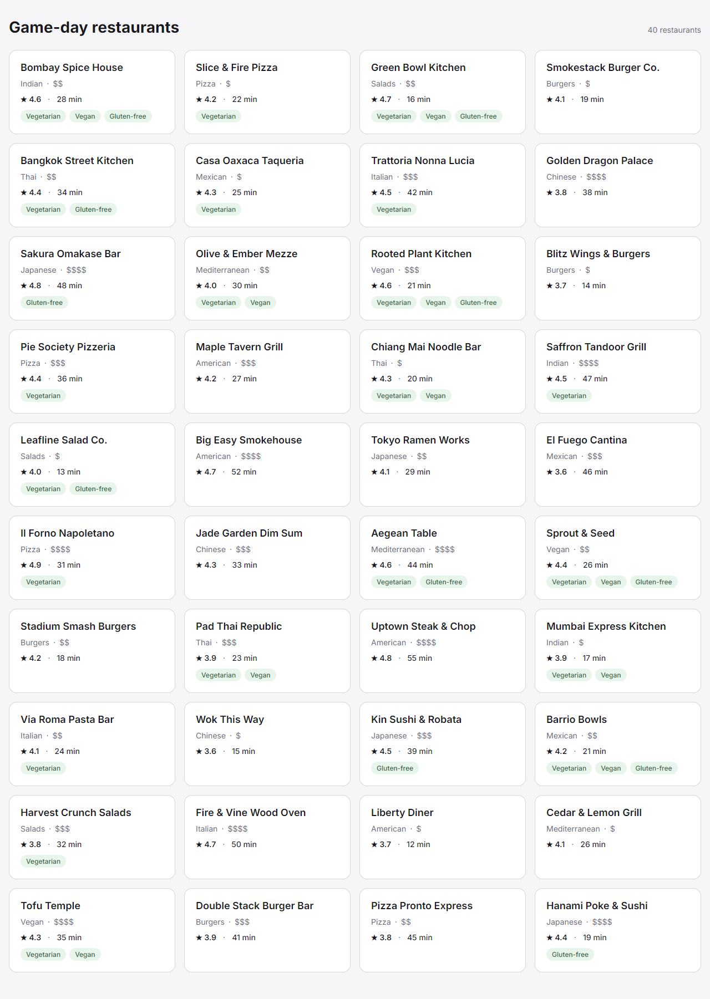

# Uber Eats Game-Day Restaurants

Typed restaurant data and card UI for the Uber Eats game-day stacked-filters exercise. This step renders all 40 listings from the source spreadsheet; the filter logic comes next and runs on the types in `src/types/restaurant.ts`.

**Live:** https://uber-eats-game-day-filters.vercel.app



Full-page screenshot: [docs/all-40-cards.png](docs/all-40-cards.png)

## Data pipeline

Nothing is hand-typed. The spreadsheet in `db/` is the single source of truth.

```
db/*.xlsx ──npm run convert──▶ src/data/restaurants.json ──loadRestaurants()──▶ Restaurant[]
            (validate every row)                           (normalize at load time)
```

1. **`scripts/convert-restaurants.ts`** reads every column of the xlsx and validates every row: exact header, 40 rows, integer ids and delivery times, `price_tier` 1–4, `true`/`false` flags, rating 0–5 with one decimal, no blanks or duplicates. It collects every problem and exits non-zero without writing anything if one is found. On success it maps `price_tier` to a `PriceBand` and writes `src/data/restaurants.json`. Dietary flags are written exactly as the sheet has them.
2. **`src/services/restaurants.ts`** loads the JSON through one `normalize()` function, which:
   - treats vegan as vegetarian (one way only; vegetarian never implies vegan). Sprout & Seed, Chiang Mai Noodle Bar and Tofu Temple are vegan but not marked vegetarian in the sheet.
   - narrows `priceBand` to the `'$' | '$$' | '$$$' | '$$$$'` union and throws on anything else.

An integration test re-reads the xlsx and fails if `restaurants.json` is out of date.

## Types

`src/types/restaurant.ts` exports `PriceBand`, `Restaurant`, `FilterState` and `EMPTY_FILTERS`, where every filter is in its nothing-selected state (`null` or `[]`).

## Card

`src/components/RestaurantCard` follows the [Figma card](https://www.figma.com/design/M9gyBbaf2I1FgWQx6fFCci?node-id=1-7): name, cuisine · price band, ★ rating · delivery time, and dietary tags. The id is never shown. Styling uses plain CSS modules and Inter (`next/font`). No Tailwind.

## Structure

```
db/                    original xlsx (outside src)
scripts/               xlsx → JSON conversion and validation
src/app/               Next.js App Router page and layout
src/components/        RestaurantCard
src/services/          data loading + normalize
src/types/             Restaurant, PriceBand, FilterState
src/data/              generated restaurants.json
tests/unit/            normalize, types, sheet validation
tests/integration/     the real dataset end to end
docs/                  screenshot
```

## Commands

```bash
npm install
npm run dev          # http://localhost:3000
npm run convert      # regenerate src/data/restaurants.json from db/
npm test             # Vitest unit + integration tests
npm run typecheck
npm run build
npm run screenshot   # with the app running on :3000, regenerates docs/all-40-cards.png (uses Microsoft Edge)
```
